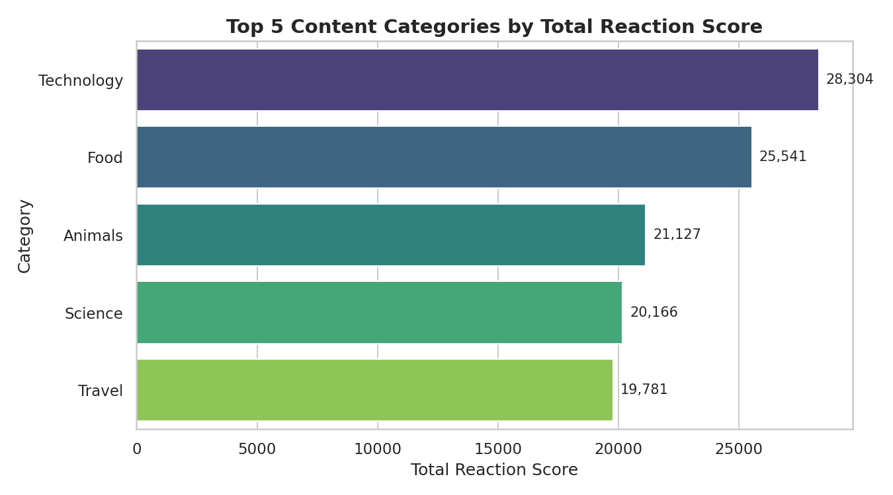
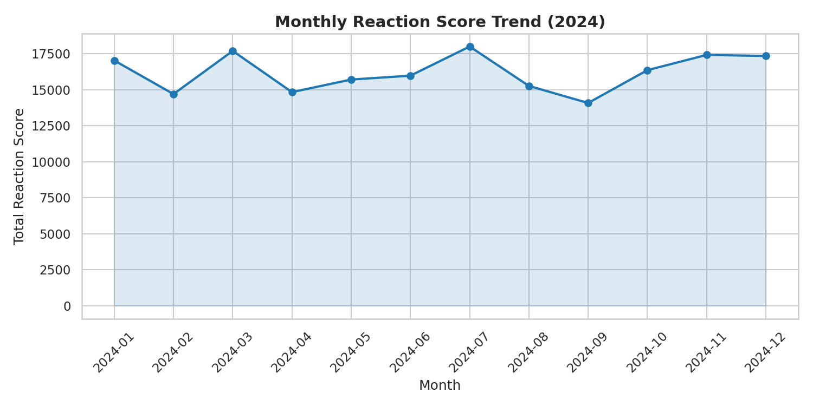
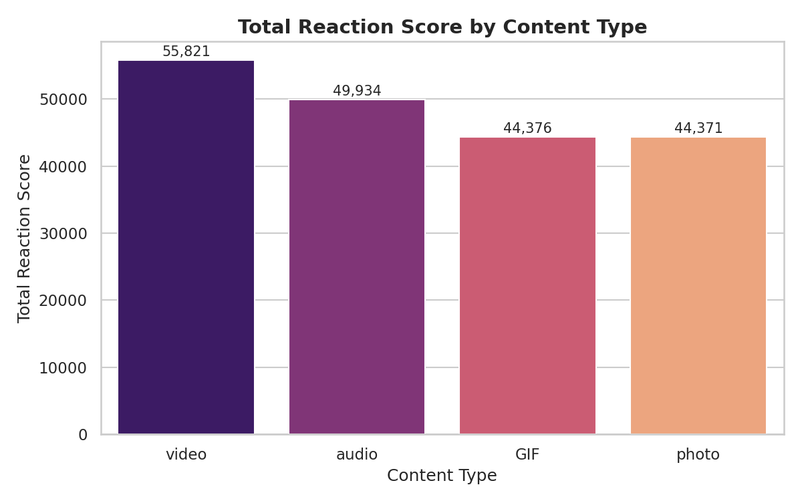
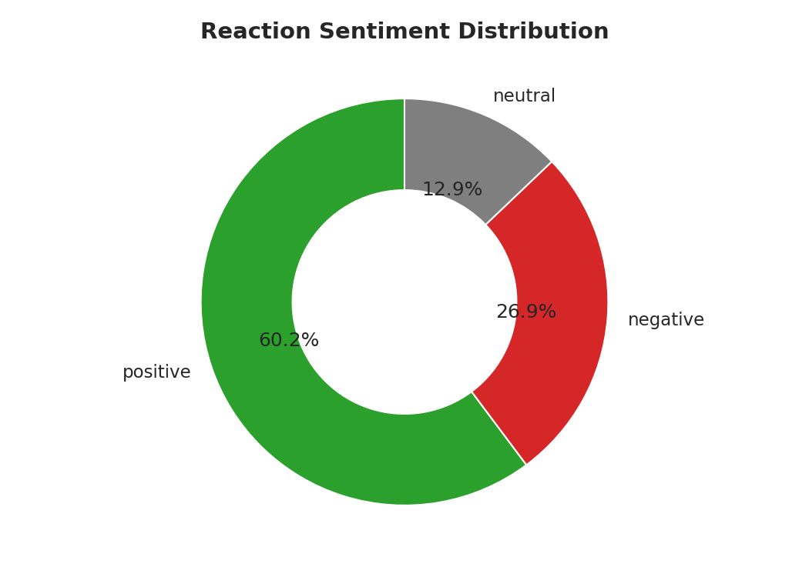

# Social Buzz — Data Analytics & Visualization

A portfolio project modeled on the **Accenture Forage "Data Analytics and
Visualization" job simulation** (fictional client: **Social Buzz**, a social
media company). It demonstrates the full analyst workflow: **data cleaning →
data modeling → analysis → visualization → storytelling**, using Python.

> **Note:** All data in this project is **synthetic and simulated for
> portfolio purposes** — generated by `scripts/00_generate_data.py` with a
> fixed random seed. No real user data is used. Figures are illustrative of
> method, not of any real company.

## Business problem

Social Buzz wants to understand what content performs best so it can shape
its content strategy: which categories should it invest in, which content
formats drive engagement, when does engagement peak, and how does the
audience feel about the content?

## Approach

| Stage | What was done |
|---|---|
| **Cleaning** (`scripts/01_cleaning.py`) | Removed rows with missing values, dropped irrelevant columns (`URL`, `Platform`), coerced `Datetime` to a proper datetime type (dropping unparseable values) |
| **Modeling** (`scripts/01_cleaning.py`) | Merged the three tables on `Content ID` / `Reaction Type`; computed total reaction score per content item with groupby-sum |
| **Analysis** (`scripts/02_analysis.py`) | Top-5 categories by score; monthly reaction trend; breakdown by content type; sentiment distribution |
| **Visualization** (`scripts/03_visualization.py`) | Four publication-style charts saved as PNGs in `dashboard/` |
| **Storytelling** | Key findings below, written as client-ready takeaways |

## Tools & their Excel / Power BI equivalents

| Python (this project) | Excel / Power BI equivalent |
|---|---|
| `pandas.merge()` | VLOOKUP / XLOOKUP, Power BI table relationships |
| `groupby().sum()` | SUMIF / SUMIFS, Power BI SUMX measure |
| `dropna()` | Go To Special → Blanks → delete rows |
| `pd.to_datetime()` | Text to Columns / Power Query type change |
| `matplotlib` / `seaborn` charts | Power BI visuals (bar, line, donut) |
| `value_counts()`-style aggregations | PivotTables |

## Key findings (actual script output)

From **4,670 cleaned reactions across 484 content items** (Jan–Dec 2024):

**Top 5 categories by total reaction score**
1. Technology — 28,304
2. Food — 25,541
3. Animals — 21,127
4. Science — 20,166
5. Travel — 19,781

**Monthly trend:** engagement peaked in **July 2024** (425 reactions, score
18,010) and was quietest in **September 2024** (335 reactions, score
14,085); the monthly average was 389 reactions.

**Content type performance:** video led on total score (55,821 across 1,337
reactions), while audio had the highest average score per reaction (42.8).
GIF (44,376) and photo (44,371) were nearly tied on total score.

**Sentiment:** 60.2% positive (2,812), 26.9% negative (1,257), 12.9% neutral
(601) — the audience skews clearly positive.

**Recommendations for Social Buzz:** double down on Technology and Food
content; prioritize video format for reach; plan major campaigns around the
mid-year engagement peak; monitor the ~27% negative reactions for content
quality signals.

## Data cleaning summary (actual output)

- Content rows: 500 → 485 (15 removed)
- Reaction rows: 5,000 → 4,892 (108 removed)
- Null / unparseable values removed: 123
- Merged modeled rows: 4,670

## Project structure

```
social-buzz-data-analytics/
├── data/
│   ├── raw/                  # synthetic source CSVs (Content, Reactions, ReactionTypes)
│   └── cleaned/              # modeled merged dataset (social_buzz_cleaned.csv)
├── scripts/
│   ├── 00_generate_data.py   # synthetic data generator (seeded, reproducible)
│   ├── 01_cleaning.py        # cleaning + modeling
│   ├── 02_analysis.py        # analysis -> results/*.csv
│   └── 03_visualization.py   # charts -> dashboard/*.png
├── results/                  # analysis CSVs (top5, monthly trend, by type, sentiment, content scores)
├── dashboard/                # PNG charts
└── README.md
```

## How to run

Requires Python 3 with `pandas`, `matplotlib`, `seaborn` (install with
`pip install --user pandas matplotlib seaborn` if missing).

```bash
cd social-buzz-data-analytics
python3 scripts/00_generate_data.py   # (optional) regenerate synthetic data
python3 scripts/01_cleaning.py       # clean + model -> data/cleaned/
python3 scripts/02_analysis.py       # analyze -> results/
python3 scripts/03_visualization.py  # charts -> dashboard/
```

## Dashboard





